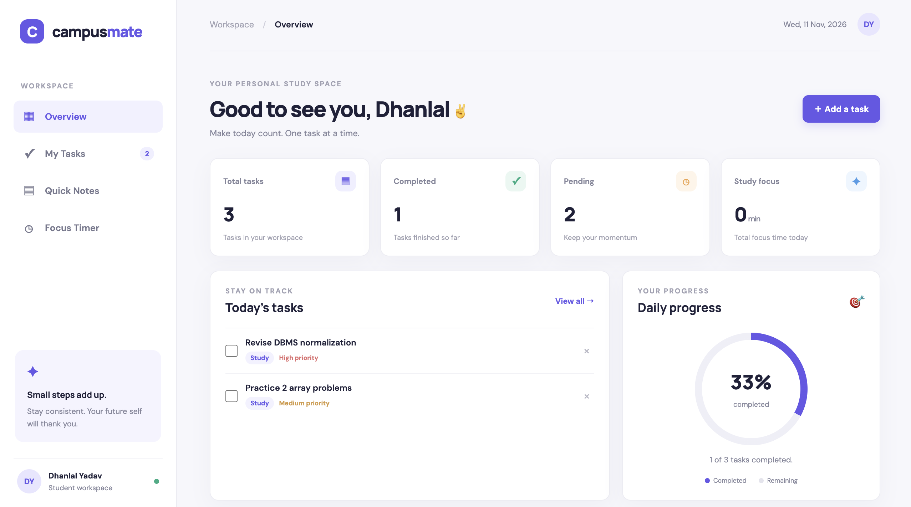

# CampusMate – Student Productivity Dashboard

CampusMate is a simple student productivity dashboard made using HTML, CSS and JavaScript. It helps students manage their daily tasks, write notes and focus on their studies.

## Features

- Dashboard to check daily task progress
- Add and delete tasks
- Mark tasks as completed
- Search and filter tasks
- Set task priorities and categories
- Add and save quick notes
- Focus timer for study sessions
- Saves tasks and notes using browser Local Storage
- Responsive design for different screen sizes

## Technologies Used

- HTML5
- CSS3
- JavaScript
- Local Storage

## Project Structure

```text
campusmate/
├── index.html
├── style.css
├── script.js
└── README.md
```

## Live Demo

[Click here to open CampusMate](https://ydhanlal04-maker.github.io/campusmate/)

## How to Run Locally

1. Clone the repository:

   ```bash
   git clone https://github.com/ydhanlal04-maker/campusmate.git
   ```

2. Open the downloaded folder.
3. Open `index.html` in your browser.

You can also run it using the Live Server extension in VS Code.

## About the Project

I made this project to practice HTML, CSS and JavaScript and to build something useful for students.

The project stores data in the browser using Local Storage. Tasks and notes do not automatically sync between different devices.

## Author

**Dhanlal Yadav**

GitHub: [ydhanlal04-maker](https://github.com/ydhanlal04-maker)

## Project Screenshot




